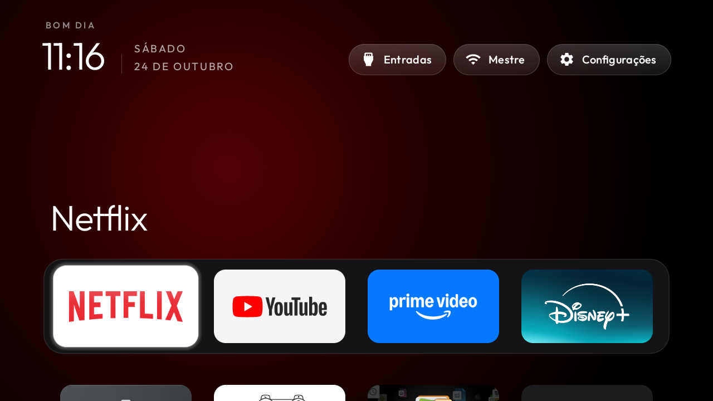

# AIWA Clean TV

Configuração de uma TV AIWA/KTC com uma tela inicial minimalista e desativação reversível
de componentes de publicidade e telemetria, baseada no [CleanYourTV](https://github.com/Gathin23/cleanyourtv).

Este repositório reúne a fonte utilizada, o perfil aplicado e os scripts de instalação e
restauração. O ajuste foi realizado e validado em **24 de outubro de 2026**.

## Antes e depois

| Antes — tela inicial original | Depois — AIWA Clean TV |
| :---: | :---: |
|  |  |

Capturas reais, sem edição, de **24/10/2026**. A imagem de depois foi registrada após
reiniciar a TV, confirmando que o launcher novo permaneceu ativo.

## Estado atual

**Instalado, funcionando e validado após reinício.** O proprietário confirmou que os
botões do controle funcionam. O ADB TCP na porta **5555 permanece aberto por solicitação
do proprietário**, para permitir melhorias futuras. Como as autorizações foram revogadas
durante o encerramento, uma nova conexão poderá pedir confirmação na tela da TV.

| Item | Valor observado |
| --- | --- |
| Marca / fabricante | AIWA / KTC |
| Modelo informado pelo sistema | SMART TV |
| Produto | `KTC_AIWA_2K_SA_21V2` |
| Placa / dispositivo | `stanford` |
| Sistema | Android 14, SDK 34 |
| Build | `UKNV.260602.001` |
| Kernel | `5.15.192+` |
| Launcher instalado | `com.gathin.tvhome`, versão 2.7 |
| Conexão usada | Wi-Fi |
| Inventário | 142 pacotes originais preservados; 143 após acrescentar o launcher |

Somente as duas capturas da tela inicial acima foram selecionadas para publicação;
elas mostram o nome da rede e o avatar visíveis na interface. Capturas de configurações
e contas, o endereço da TV, identificadores individuais, chaves ADB e backups ficam
apenas no ambiente local e não fazem parte do repositório.

## O que foi feito

1. Inventário dos pacotes, estados habilitados/desabilitados, propriedades e configurações
   do sistema antes da primeira alteração.
2. Registro de restauração pelo mecanismo oficial do CleanYourTV.
3. Compilação e instalação do launcher a partir da fonte, sem root ou alteração do firmware.
4. Configuração de quatro favoritos, nesta ordem: **Netflix, YouTube, Prime Video e Disney+**.
5. Troca do Home para o launcher novo, com a tela original desativada somente após a
   instalação e a abertura do substituto.
6. Desativação dos componentes abaixo, em lotes pequenos, com capturas entre os lotes.
7. Testes de abertura dos quatro apps, navegação, configurações, rede, reinício e controle físico.

A tela possui fundo escuro com iluminação ambiente, dock dos favoritos, grade dos demais
apps e atalhos para Entradas, Rede e Configurações. Os outros aplicativos e seus dados
continuam disponíveis.

### Componentes desativados

| Pacote | Finalidade |
| --- | --- |
| `tv.anoki.acr.anokiacroptin` | Reconhecimento automático de conteúdo / consentimento ACR |
| `com.google.android.feedback` | Feedback e relatórios de falhas |
| `android.autoinstalls.config.ktc.pai` | Configuração de instalação de apps parceiros |
| `com.android.adservices.api` | Serviços de publicidade do Android |
| `com.android.ondevicepersonalization.services` | Personalização de publicidade |
| `com.android.federatedcompute.services` | Computação federada para personalização |
| `com.google.android.tvrecommendations` | Recomendações e conteúdo patrocinado da tela original |
| `com.google.android.tvlauncher` | Tela inicial original |

**Nada foi desinstalado.** O TalkBack já estava desativado antes do trabalho e permaneceu
assim; ele não faz parte das oito desativações deste perfil.

### Componentes e configurações preservados

Apps de streaming, jogos, gerenciadores de arquivos, contas, Google Play Store, Play Services,
assistente de voz, Chromecast, atualizações, teclado, Bluetooth, controle remoto, TV ao vivo,
HDMI, reprodução de mídia e configurações de imagem/som foram preservados.

`fusion.android.tv.demo` foi mantido porque, neste firmware, também recebe a ação do botão
de entradas. Os menus de fábrica e o personalizador MediaTek foram mantidos. Nenhum menu
de fábrica foi aberto e nenhum auxiliar de acessibilidade para remapear teclas foi ativado.

DNS, escalas de animação e a configuração de resolução existente permaneceram iguais ao
backup. Não foi aplicado bloqueio de anúncios por DNS.

## Particularidade deste firmware

O launcher original possui prioridade 2 para Home. Executar somente
`cmd package set-home-activity` retornou `Success`, mas manteve o Home original.
O procedimento que funcionou foi o instalador oficial com
`-StockLauncher com.google.android.tvlauncher`, que abre o substituto antes de desativar
o antigo e verifica o resultado.

O Home passou a resolver para `com.gathin.tvhome/.MainActivity` e continuou assim após
reiniciar. `com.google.android.tungsten.setupwraith` permaneceu habilitado; não era
candidato HOME nesta TV, e não foi necessário mexer na rede salva.

O menu indicava depuração por Wi-Fi TLS desativada, mas a porta ADB TCP tradicional 5555
continuou aberta após o proprietário informar que desligou a depuração USB e reiniciou.
O proprietário então optou por manter esse acesso disponível. O launcher funciona sem ADB;
essa é uma preferência de manutenção, não um requisito da interface.

## Estrutura

| Caminho | Conteúdo |
| --- | --- |
| `cleanyourtv-main/` | Snapshot da fonte original, com o dock personalizado |
| `cleanyourtv-main/launcher/app/src/main/res/values/config.xml` | Configuração do launcher desta TV |
| `debloat.txt` | Lista completa das oito desativações |
| `batches/` | Listas separadas por etapa |
| `install.ps1` | Instalação com o instalador oficial, registro de recuperação e verificação do Home |
| `restore.ps1` | Restauração pelo registro original, sem remover o launcher novo |
| `UPSTREAM.md` | Origem, integridade e licenças da fonte |

O snapshot inclui os exemplos, temas, ferramentas e testes do projeto original. A única
personalização na fonte do launcher foi o array `dock_apps` em `config.xml`.
Os add-ons presentes na fonte original não foram instalados na TV.

## Ambiente e reinstalação

São necessários Windows/PowerShell, Python, JDK 17 ou superior, Android SDK plataforma 34,
Build Tools 34.0.0 e Gradle 8.9, conforme a configuração do projeto original. Na sessão de
validação foi utilizado o JDK 21 distribuído com o Android Studio.

As dependências não são versionadas nem instaladas por um script de preparação deste
perfil. Em uma nova máquina, prepare o ambiente explicitamente. Por exemplo, usando um
Python já instalado:

```powershell
$python = 'CAMINHO_PARA_PYTHON\python.exe'
& $python -m venv .\cleanyourtv-main\tools\venv
& .\cleanyourtv-main\tools\venv\Scripts\python.exe -m pip install -r .\cleanyourtv-main\tools\requirements.txt
```

Configure `JAVA_HOME` e `ANDROID_HOME` se necessário. O instalador também reconhece o JDK
do Android Studio no local padrão. Uma pasta local `android-sdk/`, quando presente, tem
preferência para o SDK, e `gradle-home/` é usada para o cache do Gradle.

Nesta máquina, o ambiente já utilizado foi reaproveitado por junções locais ignoradas
pelo Git, sem reinstalar dependências. Essas junções não são publicadas.

Com a TV ligada, na mesma rede e com ADB autorizado:

```powershell
& .\install.ps1 -TvHost 'IP_DA_TV'
```

Esse comando instala o launcher e configura o Home. Os lotes de telemetria não são
reaplicados automaticamente. Não reaplique listas de outras TVs a esta placa.

## Restauração

A restauração depende do **registro original local**, criado antes das alterações.
Ele fica em `~/.cleanyourtv/`, com uma cópia no backup local. Esses arquivos não são
publicados porque contêm informações do dispositivo e do ambiente.

```powershell
& .\restore.ps1 -TvHost 'IP_DA_TV'
```

O script exige o registro correspondente a esta pasta e à TV informada. Se ele não existir,
interrompe a execução antes de alterar a TV. Ao preparar este repositório nesta máquina,
o registro original foi associado ao novo caminho, preservando os estados anteriores.

A restauração reabilita os componentes deste perfil e devolve o Home ao launcher original.
O launcher novo permanece instalado; não é necessário apagar seus dados. O TalkBack
previamente desativado deve continuar desativado. Uma clonagem em outra pasta/máquina
precisa receber o registro original correto antes de executar a restauração.

## Alterar o dock ou a aparência

Edite `dock_apps` em `cleanyourtv-main/launcher/app/src/main/res/values/config.xml`
e execute `install.ps1` novamente. O número de colunas continua em quatro.

Para temas sem recompilar, consulte `cleanyourtv-main/themes/README.md` e
`cleanyourtv-main/tools/theme.ps1`. Nenhum tema adicional foi aplicado nesta sessão.

## Testes e limitações

Os resultados abaixo são da configuração instalada e validada em 24/10/2026:

| Verificação | Resultado |
| --- | --- |
| `testReleaseUnitTest lintRelease assembleRelease` | Build aprovado |
| Testes Java do launcher | 226 testes; zero falhas e erros |
| Android lint | Zero erros; 82 avisos |
| APK release | 509.393 bytes, abaixo do limite de 524.288 bytes |
| Suíte Python geral no Windows | 877 testes; 2 falhas, 121 erros, 22 ignorados |
| Causas dos erros Python | 109 ocorrências de WinError 2 por executáveis ausentes; 12 de WinError 1314 por privilégios de links simbólicos |
| Causa das duas falhas Python | Testes de documentação esperavam `tools/venv/bin/pip`, enquanto o ambiente Windows utiliza `Scripts` |
| Quatro favoritos | Abertura e retorno ao Home aprovados |
| Navegação | Dock, grade, Entradas, Configurações e Wi-Fi aprovados |
| Reinício | Home e conjunto exato de pacotes desativados preservados |
| Controle físico | Home, setas/OK, Entradas, Configurações, volume, microfone e atalhos aprovados pelo proprietário |
| Preservação | Todos os 142 pacotes originais presentes; DNS e animações iguais ao backup |
| Restauração completa | Plano gerado e inspecionado; reversão completa não executada |

Nenhum teste foi removido ou alterado para ocultar falhas. Os testes Python utilizaram
`TV_HOST=127.0.0.1`. Não foram utilizados vídeos pessoais nos testes automatizados.
Reprodução protegida/DRM, imagem HDMI/TV ao vivo, transmissão Cast e CEC não foram testadas
automaticamente. Não se afirma que anúncios internos dos apps sejam bloqueados.

Para repetir a validação Android, com as ferramentas preparadas, execute de dentro de
`cleanyourtv-main/launcher/`:

```powershell
.\gradlew.bat --no-daemon testReleaseUnitTest lintRelease assembleRelease
```

Os testes da fonte original ficam em `cleanyourtv-main/tests/`.

A preparação deste repositório também verifica a sintaxe dos scripts, a integridade do
snapshot, os arquivos excluídos do Git e a equivalência do plano original de restauração.
O teste isolado da proteção de restauração não acessa a TV:

```powershell
& .\tests\Test-RestoreGuard.ps1
```

A checagem de espaços da importação identificou dez ocorrências preexistentes em sete
arquivos do snapshot original, incluindo licenças de fontes e quebras de linha Markdown.
Esses arquivos foram preservados. Os arquivos próprios deste perfil passaram na checagem.

## Origem e licença

O launcher, as ferramentas e o snapshot em `cleanyourtv-main/` são do projeto
[Gathin23/cleanyourtv](https://github.com/Gathin23/cleanyourtv), distribuído sob MIT.
A fonte Outfit possui licença SIL Open Font License 1.1. Os avisos e as licenças originais
foram preservados; veja [UPSTREAM.md](UPSTREAM.md).
