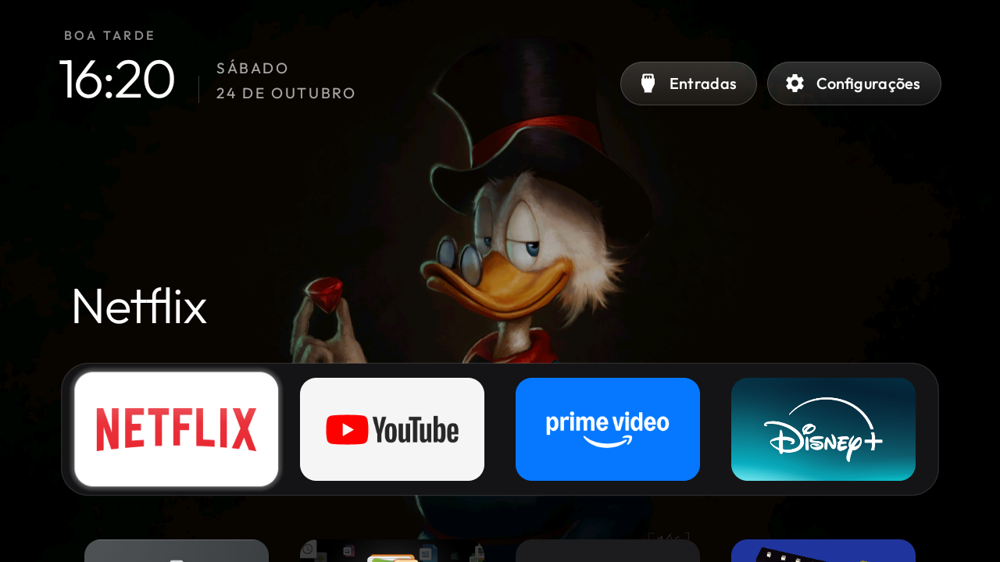
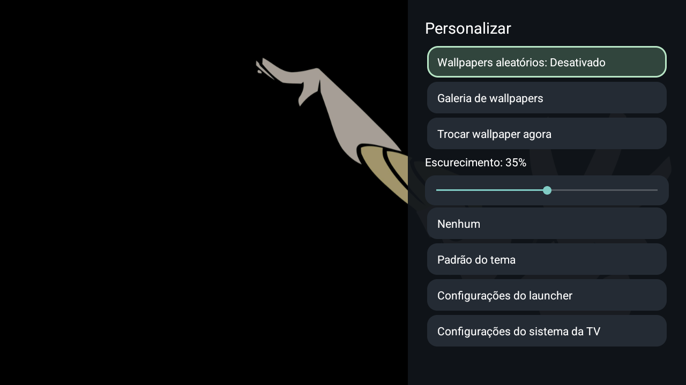
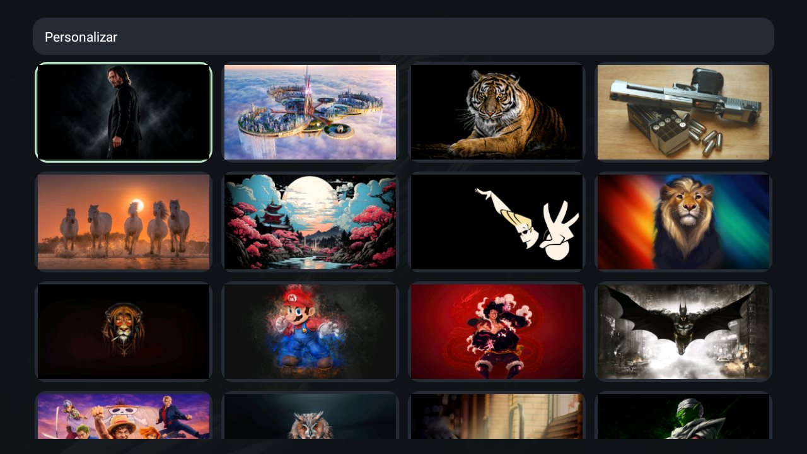

# AIWA Clean TV

Configuração de uma TV AIWA/KTC com uma tela inicial minimalista e desativação reversível
de componentes de publicidade e telemetria, baseada no [CleanYourTV](https://github.com/Gathin23/cleanyourtv).

Este repositório reúne a fonte utilizada, o perfil aplicado e os scripts de instalação e
restauração. O ajuste foi realizado e validado em **24 de outubro de 2026**.

## Antes e depois

| Antes — tela inicial original | Depois — AIWA Clean TV |
| :---: | :---: |
|  |  |

Capturas reais, sem edição, de **24/10/2026**. A imagem de depois foi registrada após
reiniciar a TV, confirmando que o launcher novo permaneceu ativo.

## Estado atual

**Instalado, funcionando e validado após reinício.** O proprietário confirmou que os
botões do controle funcionam. O ADB TCP na porta **5555 permanece aberto por solicitação
do proprietário**, para permitir melhorias futuras. A autorização deste computador
permaneceu válida após o reinício usado nos testes da versão 2.8.

| Item | Valor observado |
| --- | --- |
| Marca / fabricante | AIWA / KTC |
| Modelo informado pelo sistema | SMART TV |
| Produto | `KTC_AIWA_2K_SA_21V2` |
| Placa / dispositivo | `stanford` |
| Sistema | Android 14, SDK 34 |
| Build | `UKNV.260602.001` |
| Kernel | `5.15.192+` |
| Launcher instalado | `com.gathin.tvhome`, versão 2.8 |
| Conexão usada | Wi-Fi |
| Inventário | 142 pacotes originais preservados; 143 após acrescentar o launcher |

O comparativo inicial usa as duas capturas originais acima, que mostram o nome da rede
e o avatar visíveis na interface. O exemplo de wallpapers mais abaixo oculta o nome da
rede na própria TV durante a captura. Capturas de configurações e contas, o endereço da
TV, identificadores individuais, chaves ADB e backups ficam apenas no ambiente local.

## O que foi feito

1. Inventário dos pacotes, estados habilitados/desabilitados, propriedades e configurações
   do sistema antes da primeira alteração.
2. Registro de restauração pelo mecanismo oficial do CleanYourTV.
3. Compilação e instalação do launcher a partir da fonte, sem root ou alteração do firmware.
4. Configuração de quatro favoritos, nesta ordem: **Netflix, YouTube, Prime Video e Disney+**.
5. Troca do Home para o launcher novo, com a tela original desativada somente após a
   instalação e a abertura do substituto.
6. Desativação dos componentes abaixo, em lotes pequenos, com capturas entre os lotes.
7. Testes de abertura dos quatro apps, navegação, configurações, rede, reinício e controle físico.

A tela possui fundo escuro com iluminação ambiente, dock dos favoritos, grade dos demais
apps e atalhos para Entradas, Rede e Personalizar. Os outros aplicativos e seus dados
continuam disponíveis.

O perfil também permite os wallpapers locais descritos na seção [Wallpapers aleatórios](#wallpapers-aleatórios),
mantendo os mesmos aplicativos, dock e atalhos.

### Componentes desativados

| Pacote | Finalidade |
| --- | --- |
| `tv.anoki.acr.anokiacroptin` | Reconhecimento automático de conteúdo / consentimento ACR |
| `com.google.android.feedback` | Feedback e relatórios de falhas |
| `android.autoinstalls.config.ktc.pai` | Configuração de instalação de apps parceiros |
| `com.android.adservices.api` | Serviços de publicidade do Android |
| `com.android.ondevicepersonalization.services` | Personalização de publicidade |
| `com.android.federatedcompute.services` | Computação federada para personalização |
| `com.google.android.tvrecommendations` | Recomendações e conteúdo patrocinado da tela original |
| `com.google.android.tvlauncher` | Tela inicial original |

**Nada foi desinstalado.** O TalkBack já estava desativado antes do trabalho e permaneceu
assim; ele não faz parte das oito desativações deste perfil.

### Componentes e configurações preservados

Apps de streaming, jogos, gerenciadores de arquivos, contas, Google Play Store, Play Services,
assistente de voz, Chromecast, atualizações, teclado, Bluetooth, controle remoto, TV ao vivo,
HDMI, reprodução de mídia e configurações de imagem/som foram preservados.

`fusion.android.tv.demo` foi mantido porque, neste firmware, também recebe a ação do botão
de entradas. Os menus de fábrica e o personalizador MediaTek foram mantidos. Nenhum menu
de fábrica foi aberto e nenhum auxiliar de acessibilidade para remapear teclas foi ativado.

DNS, escalas de animação e a configuração de resolução existente permaneceram iguais ao
backup. Não foi aplicado bloqueio de anúncios por DNS.

## Particularidade deste firmware

O launcher original possui prioridade 2 para Home. Executar somente
`cmd package set-home-activity` retornou `Success`, mas manteve o Home original.
O procedimento que funcionou foi o instalador oficial com
`-StockLauncher com.google.android.tvlauncher`, que abre o substituto antes de desativar
o antigo e verifica o resultado.

O Home passou a resolver para `com.gathin.tvhome/.MainActivity` e continuou assim após
reiniciar. `com.google.android.tungsten.setupwraith` permaneceu habilitado; não era
candidato HOME nesta TV, e não foi necessário mexer na rede salva.

O menu indicava depuração por Wi-Fi TLS desativada, mas a porta ADB TCP tradicional 5555
continuou aberta após o proprietário informar que desligou a depuração USB e reiniciou.
O proprietário então optou por manter esse acesso disponível. O launcher funciona sem ADB;
essa é uma preferência de manutenção, não um requisito da interface.

## Estrutura

| Caminho | Conteúdo |
| --- | --- |
| `cleanyourtv-main/` | Snapshot da fonte original, com o dock personalizado |
| `cleanyourtv-main/launcher/app/src/main/res/values/config.xml` | Configuração do launcher desta TV |
| `debloat.txt` | Lista completa das oito desativações |
| `batches/` | Listas separadas por etapa |
| `install.ps1` | Instalação com o instalador oficial, registro de recuperação e verificação do Home |
| `restore.ps1` | Restauração pelo registro original, sem remover o launcher novo |
| `apply-wallpapers.ps1` | Envio das imagens numeradas de 1 a 34 com o perfil de troca por eventos |
| `themes/aiwa-wallpapers/config.json` | Wallpaper aleatório ao iniciar ou retornar ao Home |
| `images/1.jpg` a `images/34.jpg` | Coleção de wallpapers fornecida para este perfil |
| `UPSTREAM.md` | Origem, integridade e licenças da fonte |

O snapshot inclui os exemplos, temas, ferramentas e testes do projeto original. As
personalizações do launcher incluem o dock desta TV, a opção `wallpaper_change_on_home`
e o menu de wallpapers controlado diretamente pelo controle remoto.
Os add-ons presentes na fonte original não foram instalados na TV.

## Ambiente e reinstalação

São necessários Windows/PowerShell, Python, JDK 17 ou superior, Android SDK plataforma 34,
Build Tools 34.0.0 e Gradle 8.9, conforme a configuração do projeto original. Na sessão de
validação foi utilizado o JDK 21 distribuído com o Android Studio.

As dependências não são versionadas nem instaladas por um script de preparação deste
perfil. Em uma nova máquina, prepare o ambiente explicitamente. Por exemplo, usando um
Python já instalado:

```powershell
$python = 'CAMINHO_PARA_PYTHON\python.exe'
& $python -m venv .\cleanyourtv-main\tools\venv
& .\cleanyourtv-main\tools\venv\Scripts\python.exe -m pip install -r .\cleanyourtv-main\tools\requirements.txt
```

Configure `JAVA_HOME` e `ANDROID_HOME` se necessário. O instalador também reconhece o JDK
do Android Studio no local padrão. Uma pasta local `android-sdk/`, quando presente, tem
preferência para o SDK, e `gradle-home/` é usada para o cache do Gradle.

Nesta máquina, o ambiente já utilizado foi reaproveitado por junções locais ignoradas
pelo Git, sem reinstalar dependências. Essas junções não são publicadas.

Com a TV ligada, na mesma rede e com ADB autorizado:

```powershell
& .\install.ps1 -TvHost 'IP_DA_TV'
```

Esse comando instala o launcher e configura o Home. Os lotes de telemetria não são
reaplicados automaticamente. Não reaplique listas de outras TVs a esta placa.

## Restauração

A restauração depende do **registro original local**, criado antes das alterações.
Ele fica em `~/.cleanyourtv/`, com uma cópia no backup local. Esses arquivos não são
publicados porque contêm informações do dispositivo e do ambiente.

```powershell
& .\restore.ps1 -TvHost 'IP_DA_TV'
```

O script exige o registro correspondente a esta pasta e à TV informada. Se ele não existir,
interrompe a execução antes de alterar a TV. Ao preparar este repositório nesta máquina,
o registro original foi associado ao novo caminho, preservando os estados anteriores.

A restauração reabilita os componentes deste perfil e devolve o Home ao launcher original.
O launcher novo permanece instalado; não é necessário apagar seus dados. O TalkBack
previamente desativado deve continuar desativado. Uma clonagem em outra pasta/máquina
precisa receber o registro original correto antes de executar a restauração.

## Alterar o dock ou a aparência

Edite `dock_apps` em `cleanyourtv-main/launcher/app/src/main/res/values/config.xml`
e execute `install.ps1` novamente. O número de colunas continua em quatro.

Para temas sem recompilar, consulte `cleanyourtv-main/themes/README.md` e
`cleanyourtv-main/tools/theme.ps1`.

## Wallpapers aleatórios



Captura real da TV com o nome da rede ocultado para publicação.

O perfil usa exatamente as imagens **1.jpg a 34.jpg** da pasta `images/`, todas em
1600×900, com um total de 15.383.849 bytes. Os arquivos originais não são alterados.

Uma imagem é sorteada ao iniciar o launcher, quando a tela inicial volta ao primeiro
plano (incluindo acordar a TV) e ao pressionar Home, mesmo se a tela inicial já estiver
aberta. O sorteio evita repetir imediatamente a imagem anterior e mantém essa referência
entre reinícios. Ficar parado na tela inicial mantém a imagem escolhida.

A implementação reutiliza o leitor de wallpapers do launcher: os arquivos são enviados
uma única vez e usados localmente, sem internet. As trocas posteriores decodificam a imagem
fora da thread da interface, ajustada à resolução da tela, usando o executor já existente.
Toques repetidos em Home são agrupados em uma solicitação pendente, sem criar uma fila
de imagens ou processos adicionais. Não há temporizador novo, serviço de fundo ou nova
dependência. O APK continua abaixo de 512 KB; as imagens não ficam embutidas nele.

O perfil aplica escurecimento de 30% para legibilidade e desliga o brilho ambiente que
antes coloria o fundo conforme o app selecionado. A ordem dos quatro favoritos permanece igual.

Depois de instalar a versão do launcher deste repositório, aplique ou atualize a coleção:

```powershell
& .\apply-wallpapers.ps1 -TvHost 'IP_DA_TV'
```

O script valida a presença das 34 imagens antes de chamar a ferramenta oficial de temas,
monta uma pasta temporária com cópias e remove somente essa pasta temporária ao terminar.
Imagens adicionais fora da faixa 1–34 não entram na coleção.

O escurecimento também pode ser ajustado na TV pelo menu descrito abaixo. O valor do
JSON continua sendo o padrão quando não há uma preferência local. Para retornar à
aparência original, mantendo o launcher e a limpeza:

```powershell
& .\cleanyourtv-main\tools\theme.ps1 -TvHost 'IP_DA_TV' -Reset
```

O reset remove o tema e as cópias da coleção na TV; os originais em `images/` permanecem.

## Personalização de wallpapers pela TV

Na versão **2.8**, selecione a engrenagem **Personalizar** da Home. Todas as opções abaixo
funcionam pelas setas, OK e Voltar do controle remoto, sem ADB ou internet no uso diário.
As configurações do launcher e do sistema da TV continuam acessíveis nesse menu.



Captura real de um exemplo fixo com 35% de escurecimento. Ao encerrar os testes, foram
restaurados o sorteio ativo e os 30% do tema.

| Opção | Comportamento |
| --- | --- |
| **Wallpapers aleatórios** | Ativa ou desativa as trocas ao iniciar, acordar e voltar à Home. Desativar mantém a imagem atual fixa. |
| **Galeria de wallpapers** | Grade de quatro colunas com miniaturas das imagens locais. As setas percorrem a grade; OK abre a prévia em tela cheia. |
| **Prévia: OK / Cancelar** | OK aplica a imagem e o escurecimento da prévia imediatamente e desativa o sorteio. Cancelar ou Voltar retorna à mesma miniatura sem salvar a prévia. |
| **Trocar wallpaper agora** | Sorteia outra imagem sem repetir a atual quando há alternativas. Mantém o modo aleatório ativado ou desativado como estava. |
| **Escurecimento** | Ajuste de 0% a 70%, pelas setas esquerda/direita em passos de 5%. A prévia acompanha cada alteração. No menu, salva imediatamente; na prévia de uma imagem, salva somente ao confirmar. |
| **Nenhum / Padrão do tema** | Desliga o wallpaper ou remove somente as preferências locais de wallpaper, voltando ao tema instalado. |

### Galeria de wallpapers



Captura real da grade na TV, exportada em JPEG para reduzir o tamanho da documentação.
A coleção deste perfil contém as 34 imagens locais, sem downloads durante a navegação.

Para escolher uma imagem fixa:

1. Na Home, abra **Personalizar → Galeria de wallpapers**.
2. Use as setas para mover o destaque entre as miniaturas. A grade tem quatro colunas
   e rola automaticamente para acompanhar o foco.
3. Pressione **OK** na miniatura para abrir a imagem em tela cheia.
4. Se desejar, vá até o controle **Escurecimento** e ajuste com esquerda/direita.
5. Selecione **OK** na parte inferior para confirmar. A imagem é aplicada imediatamente
   na Home, com o escurecimento escolhido, e o modo aleatório é desativado.

A prévia começa com **Cancelar** em foco. Pressionar esse botão ou **Voltar** descarta
a escolha e os ajustes feitos nessa prévia, retornando à mesma miniatura. A confirmação
fica disponível depois que a imagem termina de carregar. Na galeria, **Voltar** retorna
ao menu; o botão **Personalizar** no topo também permite esse retorno.

O foco permanece dentro da grade nas bordas esquerda, direita e inferior, inclusive na
última linha incompleta. Seta para cima na primeira linha alcança o botão do topo;
seta para baixo nele retorna à miniatura. A ordem segue os nomes dos arquivos, e não
uma ordenação numérica: `1.jpg`, `10.jpg`, `11.jpg`, …, `2.jpg`, `20.jpg`, ….

A infraestrutura aceita JPEG (`.jpg` e `.jpeg`), PNG e WebP, até 10 MiB por arquivo e
até 100 imagens na pasta `wallpapers/`, além do `wallpaper.jpg` opcional do tema.
O script deste perfil continua enviando somente `images/1.jpg` a `images/34.jpg`.
Adicionar arquivos à pasta do computador não os transfere automaticamente para a TV.
A galeria seleciona as imagens já instaladas; não possui importação, exclusão ou edição
dos arquivos pelo controle remoto.

### Modos de troca e preferências

Com **Wallpapers aleatórios** ativado, voltar à Home, acordar a TV ou iniciar o launcher
provoca um novo sorteio. Não há troca periódica enquanto a Home fica parada. Desativar
essa opção mantém a imagem atual, inclusive depois de reiniciar a TV.

**Trocar wallpaper agora** faz apenas uma troca: se o modo estava desativado, a nova
imagem passa a ficar fixa; se estava ativado, os próximos eventos de Home e despertar
continuam sorteando. Confirmar uma imagem na galeria sempre escolhe o modo fixo.

### Persistência e desempenho

O modo fixo, a imagem e o escurecimento são salvos no armazenamento privado do app
(`launcher_settings`). A referência da última imagem continua no armazenamento já usado
pelo player (`wallpaper_rotation`). Atualizar o APK com `install -r` preserva os dados.
Usuários existentes continuam com seu tema, imagem fixa ou opção Nenhum e escurecimento
atuais; abrir o menu não grava novos padrões. O tema deste perfil começa com sorteio
ativado e escurecimento de 30%.

A galeria reutiliza o inventário e o decodificador do launcher, inclusive `wallpaper.jpg`
quando presente. As miniaturas são carregadas sob demanda, em uma única thread, com cache
limitado a 2 MiB. A prévia mantém uma imagem em tamanho de tela; ajustar o escurecimento
altera apenas uma camada preta sobre ela, sem nova decodificação. Ao sair da tela, o
executor é encerrado e as referências e o cache são liberados. O player da Home continua
aplicando o escurecimento na imagem decodificada, sem adicionar uma camada permanente.
Textos sobre a imagem receberam sombras discretas, e os atalhos superiores mantêm um
fundo escuro e seu foco original, inclusive com uma imagem clara e escurecimento de 0%.

Não foram adicionadas dependências, permissões, serviços ou mudanças em componentes do
Android. O carregamento inicial da Home segue o caminho existente. O seletor antigo de
nomes em **Configurações do launcher → Wallpaper** agora abre a mesma personalização.
O uso da engrenagem para esse menu é uma alteração deste fork AIWA.

Limites: a galeria gerencia a coleção já instalada; não importa nem baixa novas imagens
pelo controle. Arquivos ilegíveis não podem ser confirmados na prévia. Reaplicar ou
resetar um tema explicitamente continua removendo as escolhas locais, como antes;
limpar os dados ou desinstalar o app também remove as preferências. Temas antigos com
escurecimento acima de 70% mantêm esse valor até o usuário ajustar o controle novo.

### Arquivos da implementação

Os caminhos abaixo são relativos a `cleanyourtv-main/`, salvo indicação em contrário.

| Arquivos | Alteração |
| --- | --- |
| `launcher/app/src/main/java/com/gathin/tvhome/WallpaperSettingsActivity.java` | Menu, grade, prévia, escurecimento e navegação pelo controle. |
| `WallpaperPreferences.java`, `WallpaperImageLoader.java`, `WallpaperDecoder.java`, no mesmo diretório | Preferências e solicitação de troca única; cache e carregamento assíncrono; decodificador compartilhado com a Home. |
| `Config.java`, `WallpaperPlayer.java`, `WallpaperRotation.java` | Resolução das preferências, reprodução da escolha manual e inventário da galeria. |
| `MainActivity.java`, `LauncherSettingsActivity.java`, `AppAdapter.java`, `GridNavigation.java` | Entradas de navegação, retorno às configurações, contraste dos textos e limites da grade. |
| `launcher/app/src/main/AndroidManifest.xml`, `launcher/app/build.gradle` | Activity privada, versão 2.8 e build sem consultar VCS; mesmas permissões e dependências. |
| `launcher/app/src/main/res/values*/wallpaper_strings.xml` | Rótulos em todos os 25 idiomas existentes. |
| `WallpaperPreferencesTest.java`, `WallpaperGalleryNavigationTest.java`, `WallpaperRotationTest.java`, em `launcher/app/src/test/java/com/gathin/tvhome/`; `tests/test_wallpaper_resources.py` | Testes de estado, persistência, seleção, grade, inventário e traduções. |
| `README.md`, `themes/README.md`; na raiz do projeto: `README.md`, `UPSTREAM.md`, `docs/images/wallpaper-settings.png`, `docs/images/wallpaper-gallery.jpg` | Uso, arquitetura, procedência, resultados e capturas reais do menu e da galeria. |

## Testes e limitações

Os resultados abaixo são da configuração instalada e validada em 24/10/2026:

| Verificação | Resultado |
| --- | --- |
| `testReleaseUnitTest lintRelease assembleRelease`, em modo offline | Build aprovado; lint com zero erros e 81 avisos |
| Testes Java do launcher 2.8 | 253 testes; zero falhas e erros, incluindo 19 testes novos de preferências, navegação e inventário |
| Android lint | Zero erros; 81 avisos |
| APK release 2.8 | 522.472 bytes, abaixo do limite de 524.288 bytes |
| Regressões Python relevantes | 41 testes aprovados: chaves de tema, linhas das configurações, recursos hebraicos, traduções dos wallpapers e links Markdown |
| Capturas e documentação das opções | Três testes aprovados; captura real do wallpaper dentro do limite de 300 KB |
| Scripts PowerShell | Dois testes de envio de wallpapers e dois de proteção da restauração aprovados, em pastas isoladas |
| Wallpapers na TV | 34 imagens com checksums iguais aos originais; cinco Home consecutivos e retorno de Configurações trocaram o fundo; sem evento a imagem permaneceu igual |
| Wallpapers após reinício | Tema preservado, outro fundo sorteado e mesmos pacotes desativados |
| Espera e retorno | Ciclo real `Asleep` → `Awake` acionado por ADB; outro wallpaper confirmado por captura da tela |
| Personalização na TV, Android 14 | Grade e bordas, prévia e cancelamento, confirmação fixa, escurecimento 0–70% e troca manual com ambos os modos aprovados por teclas ADB na TV real |
| Persistência do modo fixo | Mesma imagem após atualização do APK, três Home, espera/retorno e reinício completo; modo desativado e escurecimento de 35% restaurados |
| Galeria sob uso repetido | Três percursos completos e três ciclos de prévia/cancelamento; foco restaurado e sem falha do launcher no buffer de crashes |
| Suíte Python geral no Windows, reexecutada para a versão 2.8 | 878 testes; 2 falhas, 121 erros, 22 ignorados; mesmas causas de ambiente da execução inicial |
| Causas dos erros Python | 109 ocorrências de WinError 2 por executáveis ausentes; 12 de WinError 1314 por privilégios de links simbólicos |
| Causa das duas falhas Python | Testes de documentação esperavam `tools/venv/bin/pip`, enquanto o ambiente Windows utiliza `Scripts` |
| Quatro favoritos | Abertura e retorno ao Home aprovados |
| Navegação | Dock, grade, Entradas, Configurações e Wi-Fi aprovados |
| Reinício | Home e conjunto exato de pacotes desativados preservados |
| Controle físico na configuração inicial | Home, setas/OK, Entradas, Configurações, volume, microfone e atalhos aprovados pelo proprietário; a validação automatizada da personalização usa os mesmos eventos de teclas Android |
| Preservação | Todos os 142 pacotes originais presentes; DNS e animações iguais ao backup |
| Restauração completa | Plano gerado e inspecionado; reversão completa não executada |

Nenhum teste foi removido ou alterado para ocultar falhas. Os testes Python utilizaram
`TV_HOST=127.0.0.1`. Não foram utilizados vídeos pessoais nos testes automatizados.
Reprodução protegida/DRM, imagem HDMI/TV ao vivo, transmissão Cast e CEC não foram testadas
automaticamente. Não se afirma que anúncios internos dos apps sejam bloqueados.

O ensaio curto da galeria não substitui um teste prolongado de memória. Não foi feito
um benchmark formal de inicialização nem validado o menu em outros modelos ou versões
de Android. O APK está próximo do limite de 512 KiB do projeto; novas funcionalidades
precisam continuar respeitando esse limite. A TV foi devolvida ao sorteio e aos 30% de
escurecimento do tema, após as escolhas temporárias usadas nos testes.

Para repetir a validação Android, com as ferramentas preparadas, execute de dentro de
`cleanyourtv-main/launcher/`:

```powershell
.\gradlew.bat --no-daemon testReleaseUnitTest lintRelease assembleRelease
```

Os testes da fonte original ficam em `cleanyourtv-main/tests/`.

A preparação deste repositório também verifica a sintaxe dos scripts, a integridade do
snapshot, os arquivos excluídos do Git e a equivalência do plano original de restauração.
O teste isolado da proteção de restauração não acessa a TV:

```powershell
& .\tests\Test-RestoreGuard.ps1
& .\tests\Test-WallpaperDeploy.ps1
```

A checagem de espaços da importação identificou dez ocorrências preexistentes em sete
arquivos do snapshot original, incluindo licenças de fontes e quebras de linha Markdown.
Esses arquivos foram preservados. Os arquivos próprios deste perfil passaram na checagem.

## Origem e licença

O launcher, as ferramentas e o snapshot em `cleanyourtv-main/` são do projeto
[Gathin23/cleanyourtv](https://github.com/Gathin23/cleanyourtv), distribuído sob MIT.
A fonte Outfit possui licença SIL Open Font License 1.1. Os avisos e as licenças originais
foram preservados; veja [UPSTREAM.md](UPSTREAM.md).
